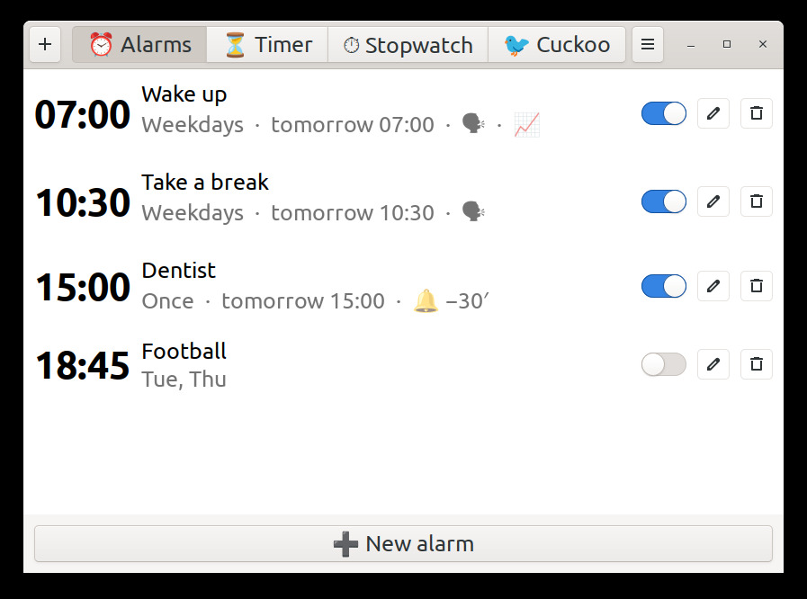
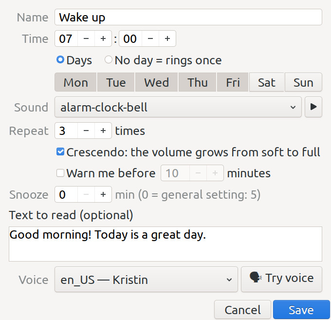
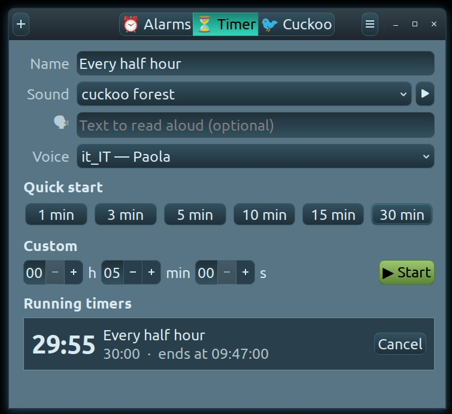
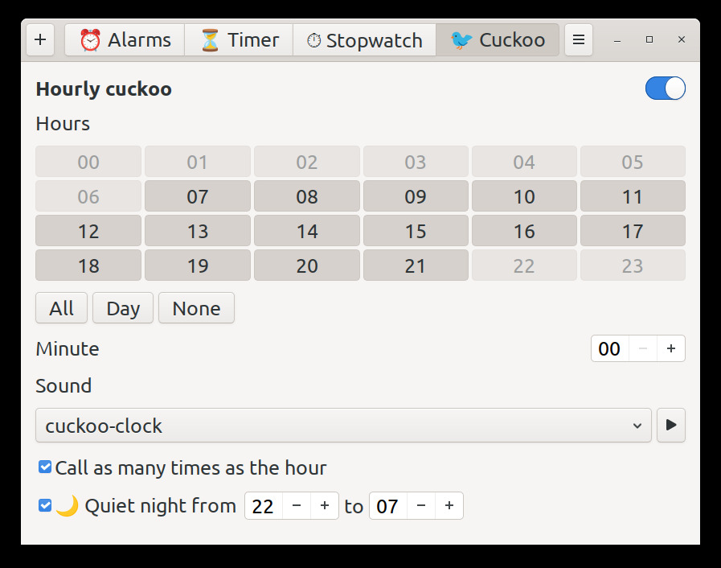
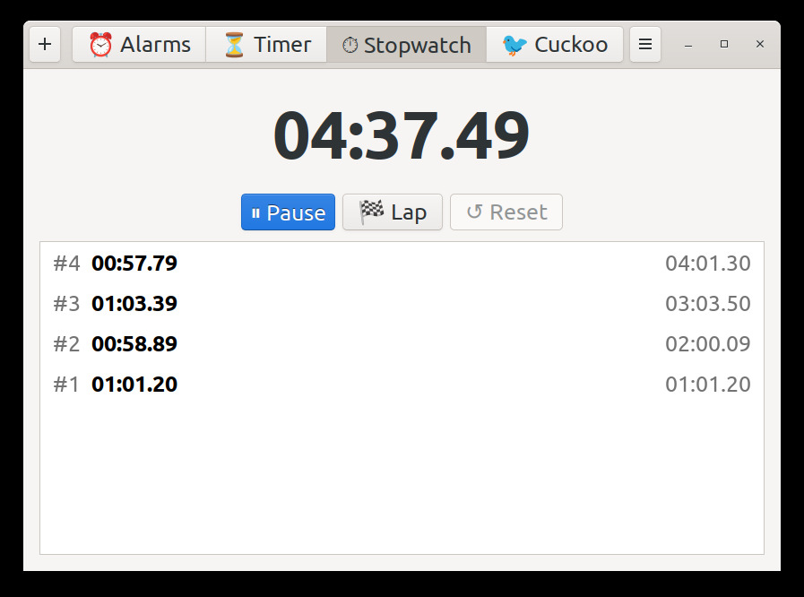
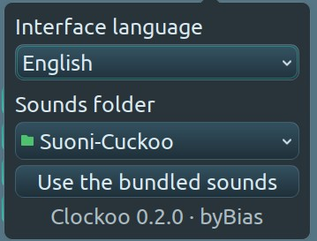

<a id="top"></a>

# 🕰️ Clockoo

[](LICENSE)

[](https://gitlab.com/FranzBias/Clockoo)


[🇬🇧 English](#english) · [🇮🇹 Italiano](#italiano) · [🇩🇪 Deutsch](#deutsch) · [🇪🇸 Español](#espanol) · [🇫🇷 Français](#francais) · [🇳🇱 Nederlands](#nederlands) · [🇷🇺 Русский](#russkiy) · [🇸🇦 العربية](#arabic) · [🇨🇳 中文](#zhongwen) · [🇯🇵 日本語](#nihongo) · [🙏 Credits](#credits)

<p align="center">
  
  
</p>
<p align="center">
  
  
</p>
<p align="center">
  
  
</p>

---

<a id="english"></a>

## 🇬🇧 English

**Clockoo** is an hourly cuckoo, alarms that can speak a text, timers, a pomodoro and a stopwatch for the Linux desktop — with a small window and a tray icon.

### ✨ Features

- **Hourly cuckoo** — pick the hours and the minute; optionally it calls **as many times as the hour**, like a real cuckoo clock. A **quiet night** silences the hours you choose.
- **Named alarms** — on chosen weekdays or just once, each with its own sound, repeat count, snooze and an optional **spoken text**; **crescendo** (from soft to full volume) and a **heads-up** some minutes before.
- **⏳ Timer** — 1 to 30 minutes or any h:m:s, **saved timers** you can sort, **pause / resume**; also from the tray menu.
- **🍅 Pomodoro** — work and breaks in a chain, with statistics for today, this week and the last 7 days.
- **⏱ Stopwatch** — with laps; it keeps counting across restarts.
- **Stop / Snooze** on every notification.
- **Rings with the window closed, and after suspend** — everything is a systemd *user* timer: it rings even if the window, the tray or Cinnamon restarts; what falls during suspend rings at wake-up, and an alarm missed while the computer was off rings at the next login.
- **13 CC0 sounds included**, or any folder of your own sounds.
- **Natural offline voices** with piper (optional), otherwise `spd-say`.
- **Mantel-clock icon** — wood on light themes, brass on dark ones.
- Interface in English, Italian and German.

### 🚀 Install

```bash
git clone https://github.com/FranzBias/Clockoo.git
cd Clockoo
./install.sh          # for the current user, no sudo
```

Needs `python3-gi`, `gir1.2-gtk-3.0`, `gir1.2-notify-0.7`, `pw-play` or `paplay`; `gir1.2-xapp-1.0` for the tray icon. Clockoo is then in your menu and starts in the tray at login.

### 🗣️ Voices (optional)

```bash
./get-voices.sh       # asks first, ~500 MB, every file checked by SHA-256
```

Downloads piper and 8 voices with free licences (IT paola, riccardo · DE kerstin, thorsten · EN kristin, ljspeech, norman, john). Without it, texts are read by speech-dispatcher.

### ⚙️ How it works

The window only edits `~/.config/Clockoo/config.json`; `clockoo_core.py` turns it into systemd user timers (`clockoo-*`), and systemd starts `clockoo_ring.py` at the right moment. See them with `systemctl --user list-timers 'clockoo-*'`.

### 📜 License

MIT — see [LICENSE](LICENSE). Voices and sounds keep their own licences: see [Credits](#credits).

[⬆ top](#top)

---

<a id="italiano"></a>

## 🇮🇹 Italiano

**Clockoo** è un cucù orario, sveglie che sanno leggere un testo, timer, un pomodoro e un cronometro per il desktop Linux — con una piccola finestra e un'icona nel tray.

### ✨ Funzioni

- **Cucù orario** — scegli le ore e il minuto; se vuoi chiama **tante volte quante sono le ore**, come un vero orologio a cucù. La **notte silenziosa** zittisce le ore che scegli.
- **Sveglie con nome** — nei giorni scelti o una volta sola, ognuna col suo suono, le sue ripetizioni, il suo posticipo e un **testo letto** facoltativo; **crescendo** (da piano a pieno volume) e un **avviso** qualche minuto prima.
- **⏳ Timer** — da 1 a 30 minuti o qualsiasi h:m:s, **timer salvati** da ordinare, **pausa / ripresa**; anche dal menu del tray.
- **🍅 Pomodoro** — lavoro e pause a catena, con le statistiche di oggi, della settimana e degli ultimi 7 giorni.
- **⏱ Cronometro** — con i giri; continua a contare anche dopo un riavvio.
- **Stop / Posticipa** su ogni notifica.
- **Suona a finestra chiusa, e dopo la sospensione** — tutto è un timer *utente* di systemd: suona anche se la finestra, il tray o Cinnamon si riavviano; ciò che cade durante la sospensione suona al risveglio, e una sveglia persa a computer spento suona all'accesso successivo.
- **13 suoni CC0 inclusi**, oppure una cartella qualsiasi di suoni tuoi.
- **Voci naturali offline** con piper (facoltativo), altrimenti `spd-say`.
- **Icona a orologio da mensola** — legno sui temi chiari, ottone su quelli scuri.
- Interfaccia in inglese, italiano e tedesco.

### 🚀 Installazione

```bash
git clone https://github.com/FranzBias/Clockoo.git
cd Clockoo
./install.sh          # per l'utente corrente, senza sudo
```

Servono `python3-gi`, `gir1.2-gtk-3.0`, `gir1.2-notify-0.7`, `pw-play` o `paplay`; `gir1.2-xapp-1.0` per l'icona nel tray. Poi Clockoo è nel menu e parte nel tray all'accesso.

### 🗣️ Voci (facoltativo)

```bash
./get-voices.sh       # chiede prima, ~500 MB, ogni file controllato con SHA-256
```

Scarica piper e 8 voci con licenze libere (IT paola, riccardo · DE kerstin, thorsten · EN kristin, ljspeech, norman, john). Senza, i testi li legge speech-dispatcher.

### ⚙️ Come funziona

La finestra modifica solo `~/.config/Clockoo/config.json`; `clockoo_core.py` lo trasforma in timer utente di systemd (`clockoo-*`), e systemd avvia `clockoo_ring.py` al momento giusto. Li vedi con `systemctl --user list-timers 'clockoo-*'`.

### 📜 Licenza

MIT — vedi [LICENSE](LICENSE). Voci e suoni hanno le loro licenze: vedi [Credits](#credits).

[⬆ inizio](#top)

---

<a id="deutsch"></a>

## 🇩🇪 Deutsch

**Clockoo** ist ein stündlicher Kuckuck, Wecker, die einen Text sprechen können, Timer, ein Pomodoro und eine Stoppuhr für den Linux-Desktop — mit einem kleinen Fenster und einem Tray-Symbol.

### ✨ Funktionen

- **Stündlicher Kuckuck** — Stunden und Minute wählen; auf Wunsch ruft er **so oft, wie es Uhr ist**, wie eine echte Kuckucksuhr. Die **ruhige Nacht** schaltet die gewählten Stunden stumm.
- **Wecker mit Namen** — an gewählten Wochentagen oder nur einmal, jeder mit eigenem Klang, eigener Wiederholung, eigenem Schlummern und optional einem **gesprochenen Text**; **Crescendo** (von leise bis voll) und ein **Hinweis** einige Minuten vorher.
- **⏳ Timer** — 1 bis 30 Minuten oder beliebige h:m:s, **gespeicherte Timer** zum Sortieren, **Pause / Fortsetzen**; auch über das Tray-Menü.
- **🍅 Pomodoro** — Arbeit und Pausen in einer Kette, mit Statistik für heute, diese Woche und die letzten 7 Tage.
- **⏱ Stoppuhr** — mit Runden; sie zählt auch nach einem Neustart weiter.
- **Stopp / Schlummern** in jeder Benachrichtigung.
- **Klingelt bei geschlossenem Fenster und nach dem Ruhezustand** — alles ist ein systemd-*Benutzer*-Timer: er klingelt auch, wenn Fenster, Tray oder Cinnamon neu starten; was in den Ruhezustand fällt, klingelt beim Aufwachen, und ein Wecker, der bei ausgeschaltetem Rechner verpasst wurde, klingelt bei der nächsten Anmeldung.
- **13 CC0-Klänge enthalten**, oder ein beliebiger eigener Klangordner.
- **Natürliche Offline-Stimmen** mit piper (optional), sonst `spd-say`.
- **Kaminuhr-Symbol** — Holz bei hellen Themen, Messing bei dunklen.
- Oberfläche auf Englisch, Italienisch und Deutsch.

### 🚀 Installation

```bash
git clone https://github.com/FranzBias/Clockoo.git
cd Clockoo
./install.sh          # für den aktuellen Benutzer, ohne sudo
```

Benötigt `python3-gi`, `gir1.2-gtk-3.0`, `gir1.2-notify-0.7`, `pw-play` oder `paplay`; `gir1.2-xapp-1.0` für das Tray-Symbol. Danach steht Clockoo im Menü und startet beim Anmelden im Tray.

### 🗣️ Stimmen (optional)

```bash
./get-voices.sh       # fragt zuerst, ~500 MB, jede Datei per SHA-256 geprüft
```

Lädt piper und 8 Stimmen mit freien Lizenzen (IT paola, riccardo · DE kerstin, thorsten · EN kristin, ljspeech, norman, john). Ohne sie liest speech-dispatcher die Texte vor.

### ⚙️ So funktioniert es

Das Fenster bearbeitet nur `~/.config/Clockoo/config.json`; `clockoo_core.py` macht daraus systemd-Benutzer-Timer (`clockoo-*`), und systemd startet `clockoo_ring.py` zur richtigen Zeit. Anzeigen mit `systemctl --user list-timers 'clockoo-*'`.

### 📜 Lizenz

MIT — siehe [LICENSE](LICENSE). Stimmen und Klänge behalten ihre eigenen Lizenzen: siehe [Credits](#credits).

[⬆ nach oben](#top)

---

<a id="espanol"></a>

## 🇪🇸 Español

**Clockoo** es un cucú horario, alarmas que pueden leer un texto, temporizadores, un pomodoro y un cronómetro para el escritorio Linux — con una pequeña ventana y un icono en la bandeja.

### ✨ Funciones

- **Cucú horario** — elige las horas y el minuto; si quieres, llama **tantas veces como la hora**, como un auténtico reloj de cuco. La **noche silenciosa** calla las horas que elijas.
- **Alarmas con nombre** — en los días elegidos o una sola vez, cada una con su sonido, sus repeticiones, su posponer y un **texto leído** opcional; **crescendo** (de suave a volumen completo) y un **aviso** unos minutos antes.
- **⏳ Temporizador** — de 1 a 30 minutos o cualquier h:m:s, **temporizadores guardados** que se pueden ordenar, **pausa / reanudar**; también desde el menú de la bandeja.
- **🍅 Pomodoro** — trabajo y pausas en cadena, con estadísticas de hoy, de la semana y de los últimos 7 días.
- **⏱ Cronómetro** — con vueltas; sigue contando tras un reinicio.
- **Parar / Posponer** en cada notificación.
- **Suena con la ventana cerrada, y después de la suspensión** — todo es un temporizador de *usuario* de systemd: suena aunque la ventana, la bandeja o Cinnamon se reinicien; lo que cae durante la suspensión suena al despertar, y una alarma perdida con el ordenador apagado suena en el siguiente inicio de sesión.
- **13 sonidos CC0 incluidos**, o cualquier carpeta de sonidos propios.
- **Voces naturales sin conexión** con piper (opcional); si no, `spd-say`.
- **Icono de reloj de chimenea** — madera en temas claros, latón en los oscuros.
- Interfaz en inglés, italiano y alemán.

### 🚀 Instalación

```bash
git clone https://github.com/FranzBias/Clockoo.git
cd Clockoo
./install.sh          # para el usuario actual, sin sudo
```

Necesita `python3-gi`, `gir1.2-gtk-3.0`, `gir1.2-notify-0.7`, `pw-play` o `paplay`; `gir1.2-xapp-1.0` para el icono de la bandeja. Después Clockoo aparece en el menú y arranca en la bandeja al iniciar sesión.

### 🗣️ Voces (opcional)

```bash
./get-voices.sh       # pregunta antes, ~500 MB, cada archivo verificado con SHA-256
```

Descarga piper y 8 voces con licencias libres (IT paola, riccardo · DE kerstin, thorsten · EN kristin, ljspeech, norman, john). Sin ellas, speech-dispatcher lee los textos.

### ⚙️ Cómo funciona

La ventana solo modifica `~/.config/Clockoo/config.json`; `clockoo_core.py` lo convierte en temporizadores de usuario de systemd (`clockoo-*`), y systemd lanza `clockoo_ring.py` en el momento justo. Puedes verlos con `systemctl --user list-timers 'clockoo-*'`.

### 📜 Licencia

MIT — ver [LICENSE](LICENSE). Las voces y los sonidos conservan sus propias licencias: ver [Credits](#credits).

[⬆ arriba](#top)

---

<a id="francais"></a>

## 🇫🇷 Français

**Clockoo** est un coucou horaire, des réveils qui savent lire un texte, des minuteurs, un pomodoro et un chronomètre pour le bureau Linux — avec une petite fenêtre et une icône dans la zone de notification.

### ✨ Fonctions

- **Coucou horaire** — choisissez les heures et la minute ; s'il le faut, il chante **autant de fois que l'heure**, comme une vraie pendule à coucou. La **nuit calme** fait taire les heures choisies.
- **Réveils nommés** — certains jours ou une seule fois, chacun avec son son, ses répétitions, son report et un **texte lu** facultatif ; **crescendo** (du doux au plein volume) et un **rappel** quelques minutes avant.
- **⏳ Minuteur** — de 1 à 30 minutes ou n'importe quel h:m:s, **minuteurs enregistrés** à trier, **pause / reprise** ; aussi depuis le menu de l'icône.
- **🍅 Pomodoro** — travail et pauses en chaîne, avec les statistiques du jour, de la semaine et des 7 derniers jours.
- **⏱ Chronomètre** — avec tours ; il continue de compter après un redémarrage.
- **Arrêter / Reporter** sur chaque notification.
- **Sonne fenêtre fermée, et après la mise en veille** — tout est un minuteur *utilisateur* de systemd : il sonne même si la fenêtre, l'icône ou Cinnamon redémarrent ; ce qui tombe pendant la veille sonne au réveil, et un réveil manqué ordinateur éteint sonne à la connexion suivante.
- **13 sons CC0 inclus**, ou n'importe quel dossier de sons à vous.
- **Voix naturelles hors ligne** avec piper (facultatif), sinon `spd-say`.
- **Icône de pendule de cheminée** — bois sur les thèmes clairs, laiton sur les sombres.
- Interface en anglais, italien et allemand.

### 🚀 Installation

```bash
git clone https://github.com/FranzBias/Clockoo.git
cd Clockoo
./install.sh          # pour l'utilisateur courant, sans sudo
```

Nécessite `python3-gi`, `gir1.2-gtk-3.0`, `gir1.2-notify-0.7`, `pw-play` ou `paplay` ; `gir1.2-xapp-1.0` pour l'icône. Clockoo est ensuite dans le menu et démarre dans la zone de notification à la connexion.

### 🗣️ Voix (facultatif)

```bash
./get-voices.sh       # demande d'abord, ~500 Mo, chaque fichier vérifié par SHA-256
```

Télécharge piper et 8 voix sous licence libre (IT paola, riccardo · DE kerstin, thorsten · EN kristin, ljspeech, norman, john). Sans elles, speech-dispatcher lit les textes.

### ⚙️ Fonctionnement

La fenêtre ne modifie que `~/.config/Clockoo/config.json` ; `clockoo_core.py` le transforme en minuteurs utilisateur systemd (`clockoo-*`), et systemd lance `clockoo_ring.py` au bon moment. Pour les voir : `systemctl --user list-timers 'clockoo-*'`.

### 📜 Licence

MIT — voir [LICENSE](LICENSE). Les voix et les sons gardent leurs propres licences : voir [Credits](#credits).

[⬆ haut](#top)

---

<a id="nederlands"></a>

## 🇳🇱 Nederlands

**Clockoo** is een koekoek op het hele uur, wekkers die een tekst kunnen voorlezen, timers, een pomodoro en een stopwatch voor de Linux-desktop — met een klein venster en een tray-pictogram.

### ✨ Functies

- **Koekoek op het hele uur** — kies de uren en de minuut; desgewenst roept hij **zo vaak als het uur**, als een echte koekoeksklok. De **stille nacht** maakt de gekozen uren stil.
- **Wekkers met een naam** — op gekozen weekdagen of één keer, elk met eigen geluid, herhaling, sluimertijd en een optionele **voorgelezen tekst**; **crescendo** (van zacht naar vol volume) en een **vooraankondiging** enkele minuten eerder.
- **⏳ Timer** — 1 tot 30 minuten of elke u:m:s, **opgeslagen timers** om te sorteren, **pauzeren / hervatten**; ook via het tray-menu.
- **🍅 Pomodoro** — werk en pauzes in een keten, met statistieken van vandaag, deze week en de laatste 7 dagen.
- **⏱ Stopwatch** — met rondetijden; telt door na een herstart.
- **Stop / Sluimer** in elke melding.
- **Gaat af met het venster dicht, en na de slaapstand** — alles is een systemd-*gebruikers*timer: hij gaat af ook als het venster, de tray of Cinnamon herstart; wat tijdens de slaapstand valt, gaat af bij het ontwaken, en een wekker die gemist werd terwijl de computer uit stond, gaat af bij de volgende aanmelding.
- **13 CC0-geluiden inbegrepen**, of een eigen map met geluiden.
- **Natuurlijke offline stemmen** met piper (optioneel), anders `spd-say`.
- **Pictogram van een schoorsteenklok** — hout bij lichte thema's, messing bij donkere.
- Interface in het Engels, Italiaans en Duits.

### 🚀 Installatie

```bash
git clone https://github.com/FranzBias/Clockoo.git
cd Clockoo
./install.sh          # voor de huidige gebruiker, zonder sudo
```

Vereist `python3-gi`, `gir1.2-gtk-3.0`, `gir1.2-notify-0.7`, `pw-play` of `paplay`; `gir1.2-xapp-1.0` voor het pictogram. Daarna staat Clockoo in het menu en start het bij het aanmelden in het systeemvak.

### 🗣️ Stemmen (optioneel)

```bash
./get-voices.sh       # vraagt eerst, ~500 MB, elk bestand gecontroleerd met SHA-256
```

Downloadt piper en 8 stemmen met vrije licenties (IT paola, riccardo · DE kerstin, thorsten · EN kristin, ljspeech, norman, john). Zonder stemmen leest speech-dispatcher de teksten voor.

### ⚙️ Hoe het werkt

Het venster bewerkt alleen `~/.config/Clockoo/config.json`; `clockoo_core.py` maakt daar systemd-gebruikerstimers van (`clockoo-*`), en systemd start `clockoo_ring.py` op het juiste moment. Bekijk ze met `systemctl --user list-timers 'clockoo-*'`.

### 📜 Licentie

MIT — zie [LICENSE](LICENSE). Stemmen en geluiden houden hun eigen licenties: zie [Credits](#credits).

[⬆ boven](#top)

---

<a id="russkiy"></a>

## 🇷🇺 Русский

**Clockoo** — это ежечасная кукушка, будильники, которые умеют зачитывать текст, таймеры, помодоро и секундомер для рабочего стола Linux — с маленьким окном и значком в трее.

### ✨ Возможности

- **Ежечасная кукушка** — выберите часы и минуту; по желанию она кукует **столько раз, сколько часов**, как настоящие часы с кукушкой. **Тихая ночь** отключает выбранные часы.
- **Именованные будильники** — в выбранные дни недели или один раз, у каждого свой звук, число повторов, отсрочка и необязательный **зачитываемый текст**; **крещендо** (от тихого до полной громкости) и **напоминание** за несколько минут.
- **⏳ Таймер** — от 1 до 30 минут или любое ч:м:с, **сохранённые таймеры** с сортировкой, **пауза / продолжение**; также из меню в трее.
- **🍅 Помодоро** — работа и перерывы цепочкой, со статистикой за сегодня, за неделю и за последние 7 дней.
- **⏱ Секундомер** — с кругами; продолжает считать после перезапуска.
- **Стоп / Отложить** в каждом уведомлении.
- **Звонит при закрытом окне и после сна** — всё это *пользовательские* таймеры systemd: звонят, даже если окно, трей или Cinnamon перезапускаются; то, что пришлось на сон, звонит при пробуждении, а будильник, пропущенный при выключенном компьютере, звонит при следующем входе.
- **13 звуков CC0 в комплекте** или любая своя папка со звуками.
- **Естественные офлайн-голоса** через piper (по желанию), иначе `spd-say`.
- **Значок каминных часов** — дерево в светлых темах, латунь в тёмных.
- Интерфейс на английском, итальянском и немецком.

### 🚀 Установка

```bash
git clone https://github.com/FranzBias/Clockoo.git
cd Clockoo
./install.sh          # для текущего пользователя, без sudo
```

Нужны `python3-gi`, `gir1.2-gtk-3.0`, `gir1.2-notify-0.7`, `pw-play` или `paplay`; `gir1.2-xapp-1.0` для значка в трее. После этого Clockoo появится в меню и будет запускаться в трее при входе.

### 🗣️ Голоса (необязательно)

```bash
./get-voices.sh       # сначала спрашивает, ~500 МБ, каждый файл проверяется по SHA-256
```

Скачивает piper и 8 голосов со свободными лицензиями (IT paola, riccardo · DE kerstin, thorsten · EN kristin, ljspeech, norman, john). Без них тексты читает speech-dispatcher.

### ⚙️ Как это работает

Окно лишь редактирует `~/.config/Clockoo/config.json`; `clockoo_core.py` превращает его в пользовательские таймеры systemd (`clockoo-*`), а systemd в нужный момент запускает `clockoo_ring.py`. Посмотреть: `systemctl --user list-timers 'clockoo-*'`.

### 📜 Лицензия

MIT — см. [LICENSE](LICENSE). У голосов и звуков свои лицензии: см. [Credits](#credits).

[⬆ наверх](#top)

---

<a id="arabic"></a>

## 🇸🇦 العربية

**Clockoo** هو وقواق كل ساعة، ومنبّهات تستطيع قراءة نص، ومؤقّتات، وبومودورو، وساعة إيقاف لسطح مكتب لينكس — مع نافذة صغيرة وأيقونة في شريط النظام.

### ✨ الميزات

- **وقواق كل ساعة** — اختر الساعات والدقيقة؛ ويمكنه أن ينادي **بعدد الساعات**، مثل ساعة وقواق حقيقية. و**الليل الهادئ** يُسكت الساعات التي تختارها.
- **منبّهات بأسماء** — في أيام مختارة أو مرة واحدة، لكلٍّ منها صوته وعدد تكراره ومدة تأجيله و**نص مقروء** اختياري؛ مع **تصاعد** الصوت (من خافت إلى كامل) و**تنبيه مسبق** قبل بضع دقائق.
- **⏳ مؤقّت** — من 1 إلى 30 دقيقة أو أي س:د:ث، و**مؤقّتات محفوظة** قابلة للترتيب، و**إيقاف مؤقت / استئناف**؛ ومن قائمة شريط النظام أيضًا.
- **🍅 بومودورو** — عمل واستراحات متتالية، مع إحصاءات اليوم والأسبوع وآخر 7 أيام.
- **⏱ ساعة إيقاف** — مع اللفّات؛ تواصل العدّ بعد إعادة التشغيل.
- **إيقاف / تأجيل** في كل إشعار.
- **يرنّ والنافذة مغلقة، وبعد السكون** — كل شيء مؤقّت *مستخدم* في systemd: يرنّ حتى لو أُعيد تشغيل النافذة أو شريط النظام أو Cinnamon؛ وما يقع أثناء السكون يرنّ عند الاستيقاظ، والمنبّه الفائت والحاسوب مطفأ يرنّ عند تسجيل الدخول التالي.
- **13 صوتًا بترخيص CC0 مضمّنة**، أو أي مجلد أصوات خاص بك.
- **أصوات طبيعية دون اتصال** عبر piper (اختياري)، وإلا `spd-say`.
- **أيقونة ساعة رفّ** — خشب في السمات الفاتحة، ونحاس في الداكنة.
- الواجهة بالإنجليزية والإيطالية والألمانية.

### 🚀 التثبيت

</div>

```bash
git clone https://github.com/FranzBias/Clockoo.git
cd Clockoo
./install.sh          # for the current user, no sudo
```

<div dir="rtl">

يتطلّب `python3-gi` و`gir1.2-gtk-3.0` و`gir1.2-notify-0.7` و`pw-play` أو `paplay`؛ و`gir1.2-xapp-1.0` لأيقونة شريط النظام. بعدها يظهر Clockoo في القائمة ويبدأ في شريط النظام عند تسجيل الدخول.

### 🗣️ الأصوات (اختياري)

</div>

```bash
./get-voices.sh       # asks first, ~500 MB, SHA-256 checked
```

<div dir="rtl">

ينزّل piper و8 أصوات بتراخيص حرّة (IT paola, riccardo · DE kerstin, thorsten · EN kristin, ljspeech, norman, john). من دونها يقرأ speech-dispatcher النصوص.

### ⚙️ كيف يعمل

النافذة تعدّل الملف `~/.config/Clockoo/config.json` فقط؛ ويحوّله `clockoo_core.py` إلى مؤقّتات مستخدم في systemd (`clockoo-*`)، ثم يشغّل systemd الملف `clockoo_ring.py` في اللحظة المناسبة. لعرضها: `systemctl --user list-timers 'clockoo-*'`.

### 📜 الترخيص

MIT — انظر [LICENSE](LICENSE). للأصوات والمؤثرات الصوتية تراخيصها الخاصة: انظر [Credits](#credits).

</div>

[⬆ الأعلى](#top)

---

<a id="zhongwen"></a>

## 🇨🇳 中文

**Clockoo** 是一款 Linux 桌面上的整点布谷钟、会朗读文字的闹钟、计时器、番茄钟和秒表——带一个小窗口和托盘图标。

### ✨ 功能

- **整点布谷** —— 选择小时和分钟；还可以像真正的布谷钟一样**按钟点数报时**。**静夜模式**让你选定的时段保持安静。
- **带名称的闹钟** —— 在选定的星期几或仅一次，每个闹钟都有自己的声音、重复次数、贪睡时间和可选的**朗读文字**；支持**渐强**（从轻到满音量）以及提前几分钟的**预先提醒**。
- **⏳ 计时器** —— 1 到 30 分钟或任意时:分:秒，**可保存并排序的计时器**，**暂停 / 继续**；也可从托盘菜单启动。
- **🍅 番茄钟** —— 工作与休息连续进行，并统计今天、本周和最近 7 天。
- **⏱ 秒表** —— 支持计圈；重启后继续计时。
- 每条通知都有**停止 / 稍后提醒**。
- **关闭窗口也会响，休眠后也会响** —— 一切都是 systemd *用户*计时器：即使窗口、托盘或 Cinnamon 重启也会响；休眠期间到点的会在唤醒时响，关机时错过的闹钟会在下次登录时响。
- **内置 13 个 CC0 音效**，也可使用你自己的任意声音文件夹。
- **离线自然语音**：piper（可选），否则使用 `spd-say`。
- **座钟图标** —— 浅色主题为木质，深色主题为黄铜。
- 界面支持英语、意大利语和德语。

### 🚀 安装

```bash
git clone https://github.com/FranzBias/Clockoo.git
cd Clockoo
./install.sh          # 仅当前用户，无需 sudo
```

需要 `python3-gi`、`gir1.2-gtk-3.0`、`gir1.2-notify-0.7`、`pw-play` 或 `paplay`；托盘图标需要 `gir1.2-xapp-1.0`。之后 Clockoo 会出现在菜单中，并在登录时启动到托盘。

### 🗣️ 语音（可选）

```bash
./get-voices.sh       # 先询问，约 500 MB，每个文件都经 SHA-256 校验
```

下载 piper 和 8 个自由许可的语音（IT paola、riccardo · DE kerstin、thorsten · EN kristin、ljspeech、norman、john）。没有它们时，由 speech-dispatcher 朗读文字。

### ⚙️ 工作原理

窗口只修改 `~/.config/Clockoo/config.json`；`clockoo_core.py` 把它转换成 systemd 用户定时器（`clockoo-*`），systemd 在正确的时刻启动 `clockoo_ring.py`。查看：`systemctl --user list-timers 'clockoo-*'`。

### 📜 许可证

MIT —— 见 [LICENSE](LICENSE)。语音和声音保留各自的许可证：见 [Credits](#credits)。

[⬆ 返回顶部](#top)

---

<a id="nihongo"></a>

## 🇯🇵 日本語

**Clockoo** は、Linux デスクトップ向けの毎時のカッコウ、テキストを読み上げるアラーム、タイマー、ポモドーロ、ストップウォッチです——小さなウィンドウとトレイアイコン付き。

### ✨ 機能

- **毎時のカッコウ** —— 時間と分を選べます。本物の鳩時計のように**時刻の数だけ鳴く**こともできます。**静かな夜**で選んだ時間帯を消音します。
- **名前付きアラーム** —— 選んだ曜日または一度だけ。それぞれに音、繰り返し回数、スヌーズ、任意の**読み上げテキスト**。**クレッシェンド**（小さな音から最大音量へ）と、数分前の**予告**も。
- **⏳ タイマー** —— 1〜30 分または任意の時:分:秒、並べ替えできる**保存タイマー**、**一時停止 / 再開**。トレイメニューからも使えます。
- **🍅 ポモドーロ** —— 作業と休憩を連続で。今日・今週・直近 7 日間の統計付き。
- **⏱ ストップウォッチ** —— ラップ付き。再起動後も計測を続けます。
- すべての通知に**停止 / スヌーズ**。
- **ウィンドウを閉じても、スリープ後も鳴る** —— すべて systemd の*ユーザー*タイマーです。ウィンドウ、トレイ、Cinnamon が再起動しても鳴り、スリープ中に来た時刻は復帰時に鳴り、電源オフ中に逃したアラームは次回ログイン時に鳴ります。
- **CC0 サウンド 13 種を同梱**、または自分のサウンドフォルダーも使えます。
- **自然なオフライン音声**は piper（任意）、なければ `spd-say`。
- **置き時計のアイコン** —— 明るいテーマでは木製、暗いテーマでは真鍮。
- インターフェースは英語・イタリア語・ドイツ語。

### 🚀 インストール

```bash
git clone https://github.com/FranzBias/Clockoo.git
cd Clockoo
./install.sh          # 現在のユーザー用、sudo 不要
```

`python3-gi`、`gir1.2-gtk-3.0`、`gir1.2-notify-0.7`、`pw-play` または `paplay` が必要です。トレイアイコンには `gir1.2-xapp-1.0`。インストール後はメニューに表示され、ログイン時にトレイで起動します。

### 🗣️ 音声（任意）

```bash
./get-voices.sh       # 事前に確認、約 500 MB、全ファイルを SHA-256 で検証
```

piper と自由なライセンスの音声 8 種類（IT paola・riccardo / DE kerstin・thorsten / EN kristin・ljspeech・norman・john）をダウンロードします。なければ speech-dispatcher が読み上げます。

### ⚙️ 仕組み

ウィンドウは `~/.config/Clockoo/config.json` を編集するだけです。`clockoo_core.py` がそれを systemd のユーザータイマー（`clockoo-*`）に変換し、systemd が適切なタイミングで `clockoo_ring.py` を起動します。確認：`systemctl --user list-timers 'clockoo-*'`。

### 📜 ライセンス

MIT —— [LICENSE](LICENSE) を参照。音声とサウンドはそれぞれのライセンスに従います：[Credits](#credits) を参照。

[⬆ トップへ](#top)

---

<a id="credits"></a>

## 🙏 Credits

### Speech engine

| Project | Licence | Source |
|---|---|---|
| piper 2023.11.14-2 (Michael Hansen / Rhasspy) | MIT | <https://github.com/rhasspy/piper> |

### Voices (downloaded only by `get-voices.sh`, never bundled)

| Voice | Language | Licence of the dataset | Dataset |
|---|---|---|---|
| paola (medium) | it_IT | CC0 1.0 | <https://huggingface.co/datasets/paolapersico1/Voice-Dataset-Italian> |
| riccardo (x_low) | it_IT | M-AILABS licence (BSD-style, text below) | M-AILABS Speech Dataset |
| kerstin (low) | de_DE | CC0 1.0 | <https://github.com/rhasspy/dataset-voice-kerstin> |
| thorsten (medium) | de_DE | CC0 1.0 | <https://github.com/thorstenMueller/Thorsten-Voice> |
| kristin (medium) | en_US | public domain | <https://librivox.org> |
| ljspeech (medium) | en_US | public domain | <https://keithito.com/LJ-Speech-Dataset/> |
| norman (medium) | en_US | public domain | <https://librivox.org> |
| john (medium) | en_US | public domain | <https://librivox.org> |

Voice models: <https://huggingface.co/rhasspy/piper-voices> (each with its `MODEL_CARD`, installed next to the voice).

<details>
<summary>M-AILABS licence (voice <i>riccardo</i>)</summary>

```
Copyright (c) 2017-2019 by the original creators @ M-AILABS

Copyright (c) 2020 I. Celeste Aurora Solak (github.com/i-celeste-aurora)

Redistribution and use in any form, including any commercial use, with or without
modification are permitted provided that the following conditions are met:

- Redistributions of source data must retain the above copyright notice, this list
  of conditions and the following disclaimer.
- Neither the name of the copyright holder nor the names of its contributors may be
  used to endorse or promote products derived from this downloaded data, source-code
  or binary-code without specific prior written permission.

THIS DATA IS PROVIDED BY THE COPYRIGHT HOLDERS AND CONTRIBUTORS "AS IS" AND ANY EXPRESS
OR IMPLIED WARRANTIES, INCLUDING, BUT NOT LIMITED TO, THE IMPLIED WARRANTIES OF
MERCHANTABILITY AND FITNESS FOR A PARTICULAR PURPOSE ARE DISCLAIMED. IN NO EVENT SHALL
THE COPYRIGHT HOLDER OR CONTRIBUTORS BE LIABLE FOR ANY DIRECT, INDIRECT, INCIDENTAL,
SPECIAL, EXEMPLARY, OR CONSEQUENTIAL DAMAGES (INCLUDING, BUT NOT LIMITED TO, PROCUREMENT
OF SUBSTITUTE GOODS OR SERVICES; LOSS OF USE, DATA, OR PROFITS; OR BUSINESS
INTERRUPTION) HOWEVER CAUSED AND ON ANY THEORY OF LIABILITY, WHETHER IN CONTRACT,
STRICT LIABILITY, OR TORT (INCLUDING NEGLIGENCE OR OTHERWISE) ARISING IN ANY WAY OUT OF
THE USE OF THIS SOFTWARE and/or DATA, EVEN IF ADVISED OF THE POSSIBILITY OF SUCH DAMAGE.
```

Source: <https://github.com/i-celeste-aurora/m-ailabs-dataset>
</details>

### Sounds (bundled in `sounds/`, all CC0 1.0)

All from [Freesound](https://freesound.org); full table with original titles in [sounds/CREDITS.md](sounds/CREDITS.md). Thanks to
DiArchangeli, finalCrystine, Monkay, Iamgiorgio, dsp9000, edschaefer, ZyryTSounds, tedthetrumpet, dland, jwheeler91, austin1234575, newagesoup and BenjaminNelan.

### Ideas

The timer presets were inspired by the Cinnamon applets *timer@Severga* and *cinnamon-timer@jake1164*; the countdown in the panel by *quick-alarm@andreas-glaser*. No code was taken from them.

[⬆ top](#top)
